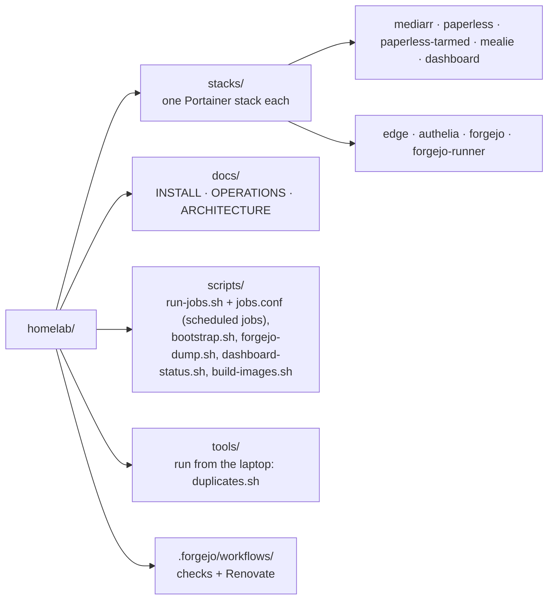

# homelab

Docker stacks for a Synology NAS, deployed by Portainer from this repository
(hosted on the NAS's own Forgejo). The NAS follows the repo: change it here,
then redeploy.

**New NAS? Start with `docs/INSTALL.md`.**

## Layout



| Doc                       | For                                           |
| ------------------------- | --------------------------------------------- |
| `docs/INSTALL.md`         | setting up a NAS from scratch, in order       |
| `docs/OPERATIONS.md`      | backups, restore, scheduled jobs, conventions |
| `docs/ARCHITECTURE.md`    | why it is built this way                      |
| `stacks/<name>/README.md` | one stack: deploy steps, gotchas              |

Each stack directory holds `compose.yaml`, `.env.example` (every variable,
no real values), `README.md`, and any config it bind-mounts — always inside
its own directory, since Portainer's Git deploy only resolves paths there.
Application **state** (databases, `/config`, media) stays on the NAS.

## Rules

- **Secrets never go in git**, not even encrypted. App secrets: Portainer's
  per-stack environment variables. Authelia: files on the NAS. CI: Forgejo
  Actions **Secrets**.
- **No real values in tracked files.** Use the placeholders below.
  Deployment-specific notes live in the gitignored
  `PRIVATE-real-values-do-not-publish/`. The tree is meant to be publishable
  as is (history is not: publish a fresh snapshot).
- **Images are pinned** to exact tags; Renovate opens weekly update PRs
  (major updates wait for approval on its Dependency Dashboard).

| Real value               | Placeholder                             |
| ------------------------ | --------------------------------------- |
| Internal / public domain | `<internal-domain>` / `<public-domain>` |
| NAS hostname / IP        | `<nas-host>` / `<nas-ip>`               |
| NAS volume paths         | `<nas-volume-path>`                     |
| PUID / PGID              | `<uid>` / `<gid>`                       |
| Email addresses          | `admin@example.com`                     |
| Tokens, passwords, keys  | name only in `.env.example`             |

## Checks

```bash
pip install pre-commit && pre-commit install
```

Every commit runs **gitleaks** (credentials) and `scripts/check-no-real-values.sh`
(real domains, IPs, paths, names; site patterns from your untracked
`.private-patterns`, see `.private-patterns.example`). CI
(`.forgejo/workflows/checks.yaml`) repeats both on every push, plus
shellcheck, the scheduler tests and paperless-tarmed's ruff and pytest.

## Updating a stack

1. Change it here (or merge Renovate's PR), push to Forgejo.
2. Portainer → Stacks → the stack → **Pull and redeploy**.

- **paperless-tarmed's image is never built by Portainer** (it rebuilt
  unreliably): the `build-images` job builds it within 15 minutes of a push,
  the dashboard shows amber "update waiting", then you redeploy. `edge` still
  builds in Portainer (`pull_policy: build`); check after a `Dockerfile` change
  that its container was recreated.
- Portainer's **Automatic updates** are fine for image-only stacks: use
  _polling_ (5 min matches Renovate's weekly cadence), not the webhook (it
  would need Forgejo → `portainer:9443` over `proxy`, never a public hostname),
  and leave _Force redeployment_ off. Not for `edge`. A merge then
  restarts containers at any hour — weigh it per stack.
- `stacks/forgejo` is a Web editor stack: paste the new compose file into
  Portainer by hand.
