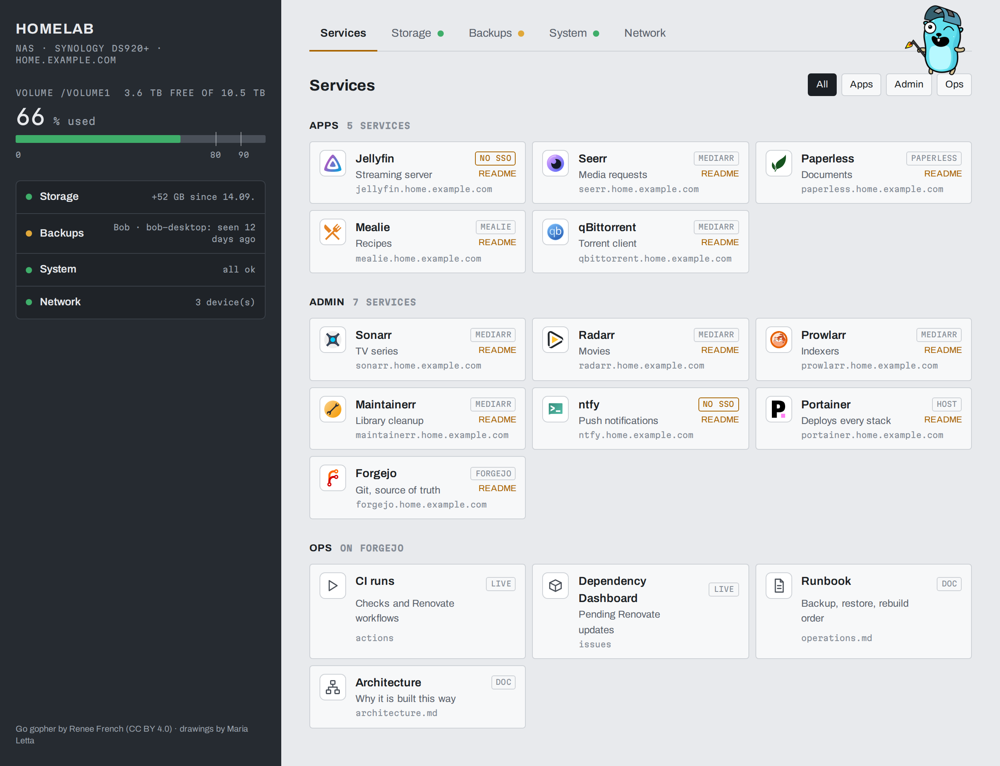
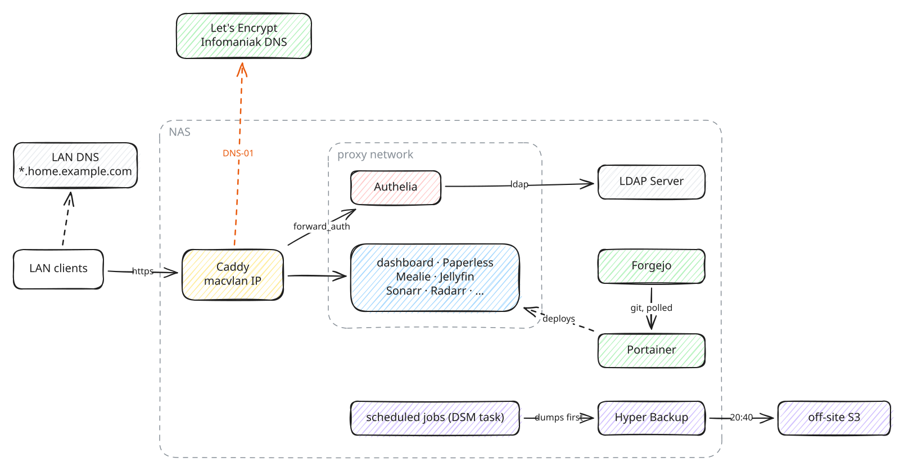

# homelab

Docker stacks for a Synology NAS: HTTPS with Let's Encrypt, single sign-on,
media automation, documents, recipes and a status dashboard, deployed by
Portainer from a self-hosted Forgejo. Everything is LAN-only; nothing is
port-forwarded.

Each part has a guide you can follow on its own: take what you need.



## How it fits together



Why each piece is there: [architecture](docs/architecture.md).

## Guides

| Guide                                                              | You get                                                                                                                                                  |
| ------------------------------------------------------------------ | -------------------------------------------------------------------------------------------------------------------------------------------------------- |
| [01 Synology prep](docs/guides/01-synology-prep.md)                | DSM ready for containers: Container Manager, SSH, folders, the `proxy` network                                                                           |
| [02 Portainer](docs/guides/02-portainer.md)                        | a web UI that deploys compose stacks, from a git repo or pasted                                                                                          |
| [03 HTTPS with Let's Encrypt](docs/guides/03-https-letsencrypt.md) | `https://<app>.home.example.com` with a wildcard certificate by DNS-01 (Infomaniak, or any provider with a Caddy plugin), Caddy on its own LAN IP        |
| [04 Forgejo and GitOps](docs/guides/04-forgejo-gitops.md)          | git on the NAS; change → push → redeploy; CI and Renovate update PRs                                                                                     |
| [05 Single sign-on](docs/guides/05-sso-authelia.md)                | Authelia over Synology's LDAP: one login, gate or OIDC per app                                                                                           |
| [06 mediarr](docs/guides/06-mediarr.md)                            | Jellyfin, Sonarr, Radarr, Prowlarr, qBittorrent, Seerr, Maintainerr, wired together                                                                      |
| [07 Paperless](docs/guides/07-paperless.md)                        | Paperless-ngx; optional paperless-tarmed for Swiss medical bills                                                                                         |
| [08 Mealie](docs/guides/08-mealie.md)                              | recipes and meal plans                                                                                                                                   |
| [09 Dashboard](docs/guides/09-dashboard.md)                        | a home page with every service and the health of jobs, backups, storage                                                                                  |
| [10 Backups and jobs](docs/guides/10-backups-and-jobs.md)          | Hyper Backup, snapshots, app dumps, one scheduler for every job                                                                                          |
| [11 Notifications](docs/guides/11-notifications.md)                | ntfy push notifications on your phone: updates waiting, failed jobs, phones that stopped backing up, disk space, bills, downloads, DSM and router events |
| [Media re-encoding](docs/guides/media-reencoding.md)               | shrink H.264 files to HEVC on a desktop GPU                                                                                                              |

The whole thing on a new NAS, in order: [install everything](docs/install-everything.md).

## Other docs

| Doc                                  | For                                                                  |
| ------------------------------------ | -------------------------------------------------------------------- |
| [architecture](docs/architecture.md) | why it is built this way                                             |
| [operations](docs/operations.md)     | the maintainer's page: rules, checks, updating, restore, conventions |
| `stacks/<name>/README.md`            | one stack's reference: variables, what it needs, gotchas             |

## Layout

```
stacks/<name>/     one Portainer stack each: compose.yaml, .env.example (every variable,
                   no real values), README.md, and any config it bind-mounts (Portainer's
                   git deploy only resolves paths inside the stack's folder)
docs/guides/       the guides above
scripts/           the scheduler (run-jobs.sh, jobs.conf) and its jobs, bootstrap.sh
tools/             run from a workstation: duplicates.sh, dashboard screenshots
.forgejo/          CI: checks and Renovate
```

Application **state** (databases, `/config`, media) stays on the NAS, never in
the repo.

Written for one Synology with DSM 7.2 and Infomaniak DNS; another DNS provider
means swapping Caddy's DNS module (guide 03, Troubleshooting).
