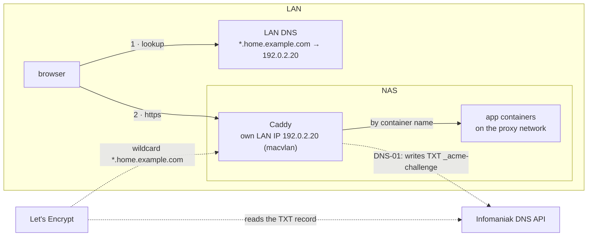

# HTTPS with Let's Encrypt and Infomaniak DNS

> **Needs:** [01 Synology prep](01-synology-prep.md) · **Optional:** [02 Portainer](02-portainer.md) (or plain `docker compose`) · **Used by:** [05 Authelia](05-sso-authelia.md), [06 mediarr](06-mediarr.md), every app with a hostname
> **Reference:** [`stacks/edge/README.md`](../../stacks/edge/README.md) · **Why it is built this way:** [architecture](../architecture.md#network-and-certificates)

## What you get

Every app on the NAS at `https://<app>.home.example.com` with a trusted
certificate, on the LAN only: nothing is port-forwarded.

**Written for Infomaniak DNS.** Any DNS provider with a Caddy DNS plugin
(Cloudflare, OVH, Gandi, deSEC, Route 53, …) works the same way: only the
token and two lines change, see [Another DNS provider](#another-dns-provider).



- **DNS-01, not HTTP-01:** Let's Encrypt checks a TXT record, not a request to
  your server, so nothing has to be reachable from the internet, and a
  wildcard certificate is possible.
- **One wildcard certificate** for all apps: the certificate transparency logs,
  which are public, show `*.home.example.com` and not the names of your apps.
- **Caddy gets its own LAN IP** (macvlan): DSM's nginx holds ports 80 and 443
  on the NAS's IP and puts them back after updates.
- **Caddy is built with the Infomaniak plugin** (`stacks/edge/Dockerfile`,
  `xcaddy`): the official image has no DNS providers.

## Before you start

| What                                | Example                     | How                                                                                                                                                                                                                                      |
| ----------------------------------- | --------------------------- | ---------------------------------------------------------------------------------------------------------------------------------------------------------------------------------------------------------------------------------------- |
| A domain whose DNS is at Infomaniak | `home.example.com`          | A subdomain of a domain you own is fine and keeps apps away from your public site. No DNS record to create: Caddy writes and removes the TXT records itself.                                                                             |
| An Infomaniak API token             | —                           | Manager → [API tokens](https://manager.infomaniak.com/v3/infomaniak-api) → create, scopes `domain:read`, `dns:read`, `dns:write`. It controls your DNS: treat it like a root password.                                                   |
| A free LAN IP for Caddy             | `192.0.2.20`                | In the LAN subnet, **outside the DHCP range** (or reserved on the router).                                                                                                                                                               |
| A MAC address for that IP           | `02:42:c0:00:02:14`         | Any locally administered unicast MAC (first byte `02`): `printf '02:%02x:%02x:%02x:%02x:%02x\n' $((RANDOM%256)) $((RANDOM%256)) $((RANDOM%256)) $((RANDOM%256)) $((RANDOM%256))`. Fixed so the router's ARP and DHCP tables stay stable. |
| The NAS's LAN interface             | `eth0`                      | `ip -br addr \| grep <nas-ip>` on the NAS. `ovs_eth0` once Open vSwitch is on (Virtual Machine Manager turns it on), `bond0` with link aggregation.                                                                                      |
| The LAN subnet and gateway          | `192.0.2.0/24`, `192.0.2.1` | `ip route` on the NAS.                                                                                                                                                                                                                   |
| Control of the LAN's DNS            | router, Pi-hole…            | To answer `*.home.example.com` with Caddy's IP (step 4).                                                                                                                                                                                 |
| The `proxy` Docker network          | —                           | `sudo docker network create proxy` (or `scripts/bootstrap.sh`). Every app Caddy serves joins it.                                                                                                                                         |

## Steps

### 1. Get the files onto the NAS

You need `stacks/edge/` (`compose.yaml`, `Dockerfile`, a Caddyfile).

- **Portainer:** fork this repo (Git stacks need a repository you can push
  your Caddyfile to), then deploy from your fork in step 3.
- **docker compose:** copy the folder, e.g. `scp -r stacks/edge <admin>@<nas-ip>:~/edge`.

Start from the minimal Caddyfile, with one test app and no Authelia:
`CADDYFILE=Caddyfile.minimal`. The full `Caddyfile` is this homelab's own setup
and needs [05 Authelia](05-sso-authelia.md).

### 2. Start a test app

```bash
sudo docker run -d --name whoami --network proxy --restart unless-stopped traefik/whoami:v1.11.0
```

Caddy reaches it as `whoami:80`, by container name over `proxy`. No port is
published.

### 3. Deploy Caddy

The variables, all from [`stacks/edge/.env.example`](../../stacks/edge/.env.example):

```bash
INTERNAL_DOMAIN=home.example.com
CADDYFILE=Caddyfile.minimal
ACME_EMAIL=you@example.com            # Let's Encrypt expiry notices
INFOMANIAK_API_TOKEN=<token>
LAN_SUBNET=192.0.2.0/24
LAN_GATEWAY=192.0.2.1
LAN_PARENT_INTERFACE=eth0
CADDY_LAN_IP=192.0.2.20
CADDY_LAN_MAC=02:42:c0:00:02:14
PROXY_GATEWAY_IP=                     # only for host services (Portainer, LDAP): see the reference
```

**With Portainer:** Stacks → Add stack → Repository, your fork's URL,
compose path `stacks/edge/compose.yaml`, the variables above → Deploy. Not the
Web editor: it cannot build the image. Details: [02 Portainer](02-portainer.md).

**With docker compose:**

```bash
cd ~/edge
cp .env.example .env && chmod 600 .env && vi .env    # the variables above
sudo docker compose up -d --build
sudo docker compose logs -f caddy
```

**Check:** the log shows `certificate obtained successfully` for
`*.home.example.com` within a minute or two (the TXT record has to propagate).

### 4. Point the LAN's DNS at Caddy

Every `*.home.example.com` → `192.0.2.20`, in the DNS your LAN clients use:

| DNS                      | How                                                                                                                     |
| ------------------------ | ----------------------------------------------------------------------------------------------------------------------- |
| MikroTik (RouterOS 7)    | `/ip dns static add name=home.example.com match-subdomain=yes address=192.0.2.20` (older: `regexp=` instead of `name=`) |
| Pi-hole / dnsmasq        | `address=/home.example.com/192.0.2.20` (Pi-hole v6: Settings → All settings → `misc.dnsmasq_lines`)                     |
| Synology DNS Server      | Primary zone `home.example.com`, one A record per app → `192.0.2.20`; hand out the NAS as DNS server by DHCP            |
| Router without wildcards | One host entry per app (`whoami.home.example.com` …). Add one with every new app.                                       |

Clients with DNS-over-HTTPS (browsers' "secure DNS", some Android "private
DNS") bypass the LAN's DNS and get no answer: turn it off for the LAN or point
it at your resolver.

### 5. Check

From another machine on the LAN, not the NAS (see Troubleshooting):

```bash
dig +short whoami.home.example.com                  # 192.0.2.20
curl -s https://whoami.home.example.com | head -3   # whoami's answer: valid certificate, no -k
curl -s https://nope.home.example.com               # Not found — no app registered at this hostname.
```

One certificate for everything:

```bash
sudo docker exec <caddy-container> ls /data/caddy/certificates/acme-v02.api.letsencrypt.org-directory/
# wildcard_.home.example.com
```

Then remove the test app: its block in your Caddyfile and `sudo docker rm -f whoami`.

## Add an app

1. The app's container joins `proxy` (in its compose file: `networks: [proxy]`, with
   `proxy: { external: true }`). Publish no ports.
2. A block in your Caddyfile, before the `*.` catch-all:
   ```
   jellyfin.{$INTERNAL_DOMAIN} {
   	import tls_wildcard
   	reverse_proxy jellyfin:8096
   }
   ```
3. Restart Caddy: `sudo docker restart <caddy-container>`, or Pull and
   redeploy in Portainer. Not `caddy reload`: the Caddyfile is a single-file
   bind mount, and after an editor or `git pull` replaces the file the running
   container still sees the old one. The wildcard covers the new name: no new
   certificate, and no DNS change unless your DNS needs one entry per host.

To put a login in front of it, see [05 Authelia](05-sso-authelia.md).

## Troubleshooting

| Symptom                                                     | Cause → fix                                                                                                                                                                    |
| ----------------------------------------------------------- | ------------------------------------------------------------------------------------------------------------------------------------------------------------------------------ |
| `curl` from the NAS to `192.0.2.20` times out               | Expected: the host cannot reach its own macvlan IP. Test from another machine. Containers on `proxy` reach Caddy through a network alias (reference: "Reaching Caddy itself"). |
| `module not registered: dns.providers.infomaniak`           | Caddy runs the stock image: the build did not happen. Rebuild (`up -d --build`, or Portainer with `pull_policy: build`) and check `docker inspect -f '{{.Created}}'` moved.    |
| Log: `401`/`403` from `api.infomaniak.com`                  | Token wrong or missing a scope (`domain:read`, `dns:read`, `dns:write`). A token change needs a redeploy: Caddy reads it at start.                                             |
| Log: `rateLimited`                                          | Too many failed or repeated orders. Switch to staging (the `acme_ca` line in the Caddyfile) until it works, then remove the line: Caddy then gets a real certificate.          |
| Certificate obtained, browser says `NXDOMAIN` or another IP | LAN DNS (step 4), or the client uses DNS-over-HTTPS.                                                                                                                           |
| Caddy does not start: `address already in use` or no LAN IP | `CADDY_LAN_IP` in use, or `LAN_PARENT_INTERFACE` wrong (`ovs_eth0`?). `sudo docker network ls`, then `inspect` the stack's `…_lan`.                                            |
| `exec: operation not permitted`                             | `cap_add: [NET_BIND_SERVICE]` removed from `compose.yaml`: the built binary needs it.                                                                                          |
| `502` for an app                                            | The app is not on `proxy`, or the name/port in `reverse_proxy` is wrong: `sudo docker exec <caddy-container> wget -qO- http://<app>:<port>`.                                   |

## Another DNS provider

Everything above stays the same except the provider's plugin and token. Find
your provider among the [caddy-dns modules](https://github.com/caddy-dns) (each
wraps a [libdns](https://github.com/libdns) package; its README says which
token and permissions it needs), then:

1. `stacks/edge/Dockerfile`: `xcaddy build --with github.com/caddy-dns/<provider>`
   instead of `…/infomaniak`.
2. The `tls_wildcard` snippet in your Caddyfile: the module's syntax instead of
   `dns infomaniak {env.INFOMANIAK_API_TOKEN}`, e.g. for Cloudflare
   `dns cloudflare {env.CF_API_TOKEN}`.
3. `compose.yaml`: pass the new variable(s) instead of `INFOMANIAK_API_TOKEN`.

No plugin for your provider? Delegate only the challenge: a `CNAME` from
`_acme-challenge.home.example.com` to a zone at a supported provider, and
Caddy's `propagation_delay`/`resolvers` options if validation is slow (see
Caddy's [`tls` directive](https://caddyserver.com/docs/caddyfile/directives/tls)).

## Next

- [05 Authelia](05-sso-authelia.md): one login in front of the apps.
- [06 mediarr](06-mediarr.md) and the other apps: each adds its block to the Caddyfile.
- Back up nothing here: Caddy gets a new certificate on its own after a loss.
  The token lives in Portainer or `.env`, not in git.
