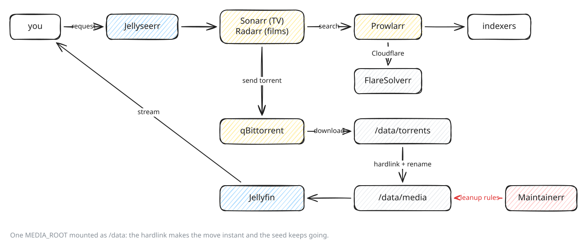

# Media: Jellyfin, Sonarr, Radarr, Prowlarr, qBittorrent

> **Needs:** [01 Synology prep](01-synology-prep.md), [03 HTTPS](03-https-letsencrypt.md) · **Optional:** [02 Portainer](02-portainer.md) (or plain `docker compose`), [05 Authelia](05-sso-authelia.md) (one login in front of the admin apps) · **Used by:** [09 dashboard](09-dashboard.md) (storage tab), [media re-encoding](media-reencoding.md)
> **Reference:** [`stacks/mediarr/README.md`](../../stacks/mediarr/README.md)

## What you get

Ask for a series or film in Seerr; it is found, downloaded, renamed into
the library and playable in Jellyfin, with hardware transcoding. Old, unwatched
items are cleaned up by rules.



| Service      | Port | Hostname                       | Role                                      |
| ------------ | ---- | ------------------------------ | ----------------------------------------- |
| jellyfin     | 8096 | `jellyfin.home.example.com`    | streaming, own login (TVs, Chromecast)    |
| seerr        | 5055 | `seerr.home.example.com`       | requests                                  |
| sonarr       | 8989 | `sonarr.home.example.com`      | TV series                                 |
| radarr       | 7878 | `radarr.home.example.com`      | films                                     |
| prowlarr     | 9696 | `prowlarr.home.example.com`    | indexers, pushed to Sonarr/Radarr         |
| qbittorrent  | 8090 | `qbittorrent.home.example.com` | downloads                                 |
| maintainerr  | 6246 | `maintainerr.home.example.com` | cleanup rules                             |
| flaresolverr | 8191 | none                           | solves Cloudflare challenges for Prowlarr |

The apps talk to each other by service name on the stack's `mediarr_net`
(`http://sonarr:8989`), never through Caddy.

## Before you start

| What                              | Example                           | How                                                                                                                  |
| --------------------------------- | --------------------------------- | -------------------------------------------------------------------------------------------------------------------- |
| HTTPS                             | `https://whoami.home.example.com` | [03 HTTPS](03-https-letsencrypt.md)                                                                                  |
| A user and group to own the files | `PUID=1000`, `PGID=1000`          | `id <user>` on the NAS. A dedicated DSM user is cleanest; it needs read/write on the media share.                    |
| A shared folder for media         | `/volume1/media`                  | DSM → Control Panel → Shared Folder. **One** share for downloads and library: see step 1.                            |
| A folder for app config           | `/volume1/docker/mediarr-config`  | Not in the media share: config is small and backed up differently.                                                   |
| A GPU for transcoding             | `/dev/dri/renderD128`             | `ls -l /dev/dri` on the NAS. Intel models (e.g. DS920+) have one; without it, remove `devices:` from `compose.yaml`. |

## Steps

### 1. Create the folders

```bash
# jellyseerr/ holds Seerr's config: the folder kept Jellyseerr's name
sudo mkdir -p /volume1/docker/mediarr-config/{sonarr,radarr,prowlarr,qbittorrent,jellyfin,jellyseerr,maintainerr}
sudo mkdir -p /volume1/media/{torrents,media/tv,media/movies}
sudo chown -R 1000:1000 /volume1/docker/mediarr-config /volume1/media
```

Why one root: Sonarr and Radarr see the whole of `MEDIA_ROOT` as `/data`, and
qBittorrent sees `MEDIA_ROOT/torrents` at the **same** path `/data/torrents`.
Downloads and library are on one filesystem and one mount, so importing a
finished download is a hardlink: instant, no second copy, and the torrent
keeps seeding. Two separate mounts would make every import a full copy.

| Container path   | Seen by                       |
| ---------------- | ----------------------------- |
| `/data`          | sonarr, radarr (`MEDIA_ROOT`) |
| `/data/torrents` | qbittorrent, sonarr, radarr   |
| `/data/media`    | jellyfin, sonarr, radarr      |

**Check:** `ls -ln /volume1/media` shows your `PUID`/`PGID`.

### 2. Deploy

Variables, from [`stacks/mediarr/.env.example`](../../stacks/mediarr/.env.example):

```bash
INTERNAL_DOMAIN=home.example.com
PUID=1000
PGID=1000
MEDIARR_CONFIG_ROOT=/volume1/docker/mediarr-config
MEDIA_ROOT=/volume1/media
```

The time zone is set in `compose.yaml` (`TZ=Europe/Zurich`); change it there
if needed.

**With Portainer:** Stacks → Add stack → Repository, compose path
`stacks/mediarr/compose.yaml`, the variables → Deploy
([02 Portainer](02-portainer.md)).

**With docker compose:** copy `stacks/mediarr/`, `cp .env.example .env`, fill
it in, `sudo docker compose up -d`.

**Check:** `sudo docker ps --filter name=mediarr` lists eight containers, all
`Up` (names depend on the stack or folder name).

### 3. Hostnames in Caddy

One block per app in your Caddyfile ([03](03-https-letsencrypt.md#add-an-app)),
service name and port from the table above. Jellyfin and qBittorrent:

```
jellyfin.{$INTERNAL_DOMAIN} {
	import tls_wildcard
	reverse_proxy jellyfin:8096
}

qbittorrent.{$INTERNAL_DOMAIN} {
	import tls_wildcard
	import authelia          # only with Authelia
	reverse_proxy qbittorrent:8090
}
```

- **With Authelia:** `import authelia` on every app except Jellyfin, plus one
  `access_control` rule each ([05](05-sso-authelia.md#4-gate-an-app)). Jellyfin
  stays outside: a Chromecast or TV app cannot complete a browser login.
- **Without Authelia:** no `import authelia` anywhere, and **keep each app's
  own login on** (skip step 4). Set it at first start: each app asks for a
  user and password.

**Check:** `https://sonarr.home.example.com` answers with a valid certificate.

### 4. Turn off the apps' own logins

Only behind Authelia, otherwise you log in twice. Stop the stack, edit, start:

```bash
C=/volume1/docker/mediarr-config
# Sonarr, Radarr, Prowlarr: no login for local addresses (Caddy's requests come from a Docker private range)
for a in sonarr radarr prowlarr; do
  sudo sed -i 's|<AuthenticationRequired>Enabled</AuthenticationRequired>|<AuthenticationRequired>DisabledForLocalAddresses</AuthenticationRequired>|' $C/$a/config.xml
done
# qBittorrent: no login from the proxy network's subnet (docker network inspect proxy), not the LAN
sudo sed -i '/^WebUI\\Address=\*$/a WebUI\\AuthSubnetWhitelistEnabled=true\nWebUI\\AuthSubnetWhitelist=172.20.0.0/16' $C/qbittorrent/qBittorrent.conf
```

Never set `AuthenticationMethod` to `None`: recent versions reject it and
lock you out.

**Check:** `https://sonarr.home.example.com` → Authelia, then Sonarr with no
second login.

### 5. qBittorrent

Get the first password: `sudo docker logs <qbittorrent-container> 2>&1 | grep -i password`
(linuxserver prints a temporary one), log in and change it. Then
Options → Downloads:

- Default save path `/data/torrents`.
- Keep incomplete torrents in `/data/torrents/incomplete` (optional).
- Categories are created by Sonarr/Radarr in step 6 (`tv`, `movies`); each
  saves to `/data/torrents/<category>`.

No port is published: peers connect outbound only. That is slower than an
open listening port but needs no port forward.

**Check:** Options → Downloads shows `/data/torrents`.

### 6. Sonarr and Radarr

In each (Settings → Media Management):

- **Root folder:** Sonarr `/data/media/tv`, Radarr `/data/media/movies`.
- **Use hardlinks instead of copy:** on (the default).

Settings → Download Clients → Add → qBittorrent:

| Field               | Sonarr        | Radarr        |
| ------------------- | ------------- | ------------- |
| Host                | `qbittorrent` | `qbittorrent` |
| Port                | `8090`        | `8090`        |
| Username / password | qBittorrent's | qBittorrent's |
| Category            | `tv`          | `movies`      |

No remote path mapping: qBittorrent and the \*arrs see the same `/data/torrents`.

Note each app's API key (Settings → General) for Prowlarr and Seerr.

**Check:** Test on the download client is green; System → Status shows no
root folder or download client warning.

### 7. Prowlarr

1. Settings → Indexers → Add (+) → **FlareSolverr**, tag `flaresolverr`,
   host `http://flaresolverr:8191`. Indexers with this tag go through it.
2. Settings → Apps → Add → Sonarr: Prowlarr server `http://prowlarr:9696`,
   Sonarr server `http://sonarr:8989`, its API key. Same for Radarr
   (`http://radarr:7878`).
3. Indexers → Add your indexers. Give the tag `flaresolverr` to those behind
   Cloudflare.

Prowlarr pushes the indexers to Sonarr and Radarr; don't add them there.

**Check:** Test on each indexer; in Sonarr, Settings → Indexers lists them
with "(Prowlarr)".

### 8. Jellyfin

1. First start at `https://jellyfin.home.example.com`: admin user, then
   libraries: **Shows** → `/data/media/tv`, **Movies** → `/data/media/movies`.
2. Dashboard → Playback → Transcoding: hardware acceleration **Intel
   QuickSync (QSV)** (or VAAPI), device `/dev/dri/renderD128`; tick the
   codecs the CPU decodes (Gemini Lake: H.264, HEVC, HEVC 10-bit, VP9).
3. Users: one per person, with their own password (Jellyfin's login is the
   only control here).

**Check:** play a file at a lower quality; Dashboard → Activity shows
`Transcoding` with a hardware codec, and the CPU stays low.

### 9. Seerr

At `https://seerr.home.example.com`:

1. Sign in with Jellyfin: server `http://jellyfin:8096`, the Jellyfin admin.
   Sync the libraries.
2. Services → Radarr: hostname `radarr`, port `7878`, the API key, quality
   profile, root folder `/data/media/movies`, **default server** on. Sonarr:
   `sonarr`, `8989`, `/data/media/tv`.
3. Users: import the Jellyfin users; they log in with their Jellyfin
   password.

**Check:** request a film; it shows in Radarr → Activity → Queue within a
minute.

### 10. Maintainerr

Settings → add Jellyfin (`http://jellyfin:8096`, an API key from Jellyfin's
Dashboard → API Keys), Sonarr, Radarr and Seerr (same hosts and keys as
above). Then Rules, e.g. "not watched for 90 days and not requested in the
last 30 → unmonitor and delete".

Nothing is deleted until a rule exists; start with a collection only, check
what it selects, then enable the action.

**Check:** a rule's collection lists the items you expect.

## Troubleshooting

| Symptom                                               | Cause → fix                                                                                                                            |
| ----------------------------------------------------- | -------------------------------------------------------------------------------------------------------------------------------------- |
| Imports are slow and use double the space             | Not hardlinks: downloads and library on different mounts or shares. Keep the single `MEDIA_ROOT` layout (step 1).                      |
| Sonarr: "path does not exist" for a finished download | qBittorrent saves outside `/data/torrents`, or the paths differ between containers. Fix the save path; don't add remote path mappings. |
| `Permission denied` writing to `/data` or `/config`   | Folders not owned by `PUID`/`PGID` (step 1).                                                                                           |
| Locked out of Sonarr/Radarr/Prowlarr                  | `AuthenticationMethod` set to `None`. Stop the app, set it back to `Forms` in `config.xml`, start.                                     |
| qBittorrent asks for a login behind Authelia          | Its whitelist is not the `proxy` subnet, or `proxy` was recreated with another subnet (step 4).                                        |
| Indexer fails with a Cloudflare challenge             | Tag it `flaresolverr`. Some challenges FlareSolverr cannot solve; disable those indexers. FlareSolverr needs about 1 GB of memory.     |
| Jellyfin transcodes on the CPU                        | `/dev/dri` not mapped, or `PUID` cannot open it: `ls -l /dev/dri`, check the group (`video`/`render`) and that the user is in it.      |
| A `.mkv` in AV1 stutters                              | The NAS's GPU cannot decode AV1: CPU transcode. Prefer HEVC ([media re-encoding](media-reencoding.md)).                                |
| 3D files show two pictures side by side               | `3D`/`SBS`/`HOU` releases. Block them with a custom format scored -10000 in Sonarr/Radarr.                                             |

## Next

- [09 dashboard](09-dashboard.md): storage per folder, including the media library.
- [Media re-encoding](media-reencoding.md): shrink large H.264 files to HEVC from a desktop.
- [10 backups](10-backups-and-jobs.md): back up `MEDIARR_CONFIG_ROOT` if you
  want to keep settings and history; media is re-downloadable.
